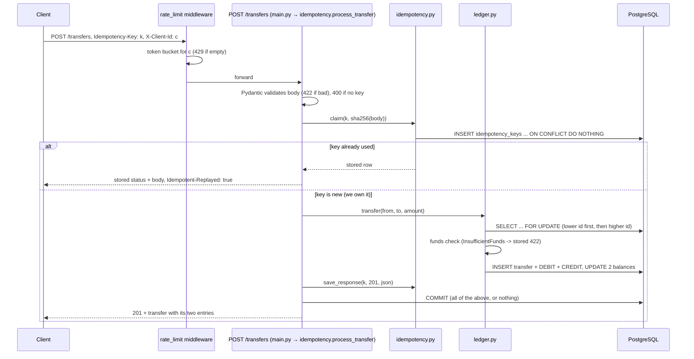

# LEARNING.md: Project 2 study guide (payment ledger)

How to use this file:
1. Read §1 with the code open.
2. Do the exercises in §4. Breaking things is the fastest way to understand why each line exists.
3. Rehearse §5 out loud.

Every number in this file comes from the one recorded run in `results/measured_run.txt`
(reproduce: `./scripts/measure_all.sh`).

Contents:
1. Architecture and the life of one transfer
2. Every file: purpose and the concept it demonstrates
3. Core concepts, tied to the code
4. Ten "break it to learn it" exercises
5. 25 interview questions, with model answers from this code
6. Limitations and next steps
7. Measured results (one run)
8. Resume bullets
- Appendix: build log, phase by phase

## 1. Architecture and the life of one transfer

**Walk-through: Asha (account 2) sends ₹120 to Ravi (account 3) with `Idempotency-Key: order-1001`.**

1. **Rate limit**: [main.py:54](app/main.py#L54). The middleware looks up the token bucket for this client
   (the `X-Client-Id` header, or else the IP) and spends one token. With no token left, it returns 429 + `Retry-After`.
   The bucket logic is in [ratelimit.py:21](app/ratelimit.py#L21).
2. **Validation**: [schemas.py](app/schemas.py) `TransferCreate`. `strict=True` rejects `"12000"` and `120.5`.
   The amount must be > 0, the two accounts must differ, and unknown fields are refused. A missing key header gives 400 ([main.py:111](app/main.py#L111)).
3. **Open a session**: `get_session()` borrows one connection from the pool ([database.py](app/database.py)).
   psycopg starts a transaction at the first statement. Nothing is visible to anyone else until COMMIT.
4. **Claim the key**: [idempotency.py:27](app/idempotency.py#L27). `INSERT INTO idempotency_keys ... ON CONFLICT (key) DO NOTHING RETURNING key`.
   - A row comes back: this request owns the key.
   - Nothing comes back: the key was used before. We read the stored row and replay it. A different body hash gives 422.
   - If another request with the same key is *in flight*, this INSERT waits on the primary-key index until that request commits.
5. **Lock the accounts**: [ledger.py:57](app/ledger.py#L57). `SELECT ... FOR UPDATE` on account 2, then account 3 (ascending id).
   Any other transfer touching account 2 now waits at its own `FOR UPDATE` until we commit.
6. **Business checks**: [ledger.py:104](app/ledger.py#L104). Both accounts exist (else 404), neither is the system account, and the
   balance is at least ₹120 (else 422). These are raised *before* any write, so the stored refusal is the only write.
7. **Double-entry write**: [ledger.py:63](app/ledger.py#L63). INSERT one `transfers` row and two `ledger_entries`
   (DEBIT 12000 on account 2, CREDIT 12000 on account 3), and UPDATE both cached balances.
8. **Store the response**: [idempotency.py:47](app/idempotency.py#L47), the exact JSON we are about to send, status 201.
9. **COMMIT**: [idempotency.py:90](app/idempotency.py#L90). Steps 4–8 become visible together, and the row locks are released.
   If the process or DB dies before this line, Postgres discards everything, *including the key claim*. The client's
   retry then runs as a first attempt.
10. **Retry**: the same request is sent again (say the response was lost). Step 4 finds the committed row and returns the
    same bytes with `Idempotent-Replayed: true`. No money moves.

## 2. Every file: purpose and the concept it demonstrates

| File | Purpose | Key concept |
|---|---|---|
| `app/main.py` | JSON routes, rate-limit middleware, 503 for DB outages; mounts the web pages | Thin HTTP layer; 503 for DB outages; 4xx for business refusals |
| `app/web.py` | HTML pages: home (ledger health + accounts), account statement, send-money form, transfer page | Server-side rendering, POST + Post/Redirect/Get, idempotency keys in forms, `Decimal` for money input |
| `app/templates/*.html` | `base.html` layout + `home`, `account`, `send`, `transfer` pages | Template inheritance, autoescaping (XSS) |
| `app/ledger.py` | Accounts, transfers, statement, audit; row locking | Double-entry, `SELECT ... FOR UPDATE`, lock ordering, window functions, invariants |
| `app/idempotency.py` | Claim a key, replay a stored response; `process_transfer()`, the one path money takes (API and web), with the one `commit()` per transfer | Idempotency, a unique index as a concurrency control, transaction boundary |
| `app/models.py` | Tables as SQLAlchemy classes, with CHECK constraints | Integer money, constraints as the last line of defence, partial unique index |
| `app/database.py` | Engine (connection pool), session factory, `get_session()`, `init_db()` | Connection pooling, `pool_pre_ping` for recovery after a DB restart |
| `app/schemas.py` | Pydantic request and response shapes | Validation at the edge (strict types, `extra="forbid"`) |
| `app/ratelimit.py` | Token bucket per client | Rate limiting, lazy refill, injectable clock for tests |
| `tests/conftest.py` | Real-Postgres fixtures; tables truncated before each test | Testing against the real database; skip locally / fail in CI |
| `tests/test_accounts.py` | Opening and reading accounts, validation | Input validation, 404 vs 422 |
| `tests/test_transfers.py` | Transfers, entries, statement, refusals | Double-entry, atomic refusal |
| `tests/test_idempotency.py` | Retry, key reuse, crash before commit | Idempotency semantics |
| `tests/test_concurrency.py` | 100 parallel transfers, opposite directions, overdraft race, same key ×20 | Race conditions, locking, deadlock avoidance |
| `tests/test_invariants.py` | Audit holds after random transfers and catches tampering | Invariants, testing the tester |
| `tests/test_ratelimit.py` | Token bucket with a fake clock, 429 over HTTP | Deterministic time in tests |
| `tests/test_web.py` | Pages render; form transfer writes DEBIT+CREDIT; same form twice moves money once; overdraft; bad amounts; escaping | Testing HTML; idempotency through a browser form |
| `tests/helpers.py` | `open_account`, `balance`, `send` | — |
| `loadtest/locustfile.py` | 50 users: new transfers, retries, reads | Load testing; client-side vs server-side counts |
| `benchmark/http_drills.py` | Latency, parallel HTTP drills, rate-limit burst | End-to-end proof through the real server |
| `benchmark/failure_drill.py` | SIGKILL Postgres during 300 transfers, retry same keys | Durability, atomicity, safe retries |
| `scripts/check_ledger.py` | Prints the audit + counts for the live DB | Reconciliation |
| `scripts/measure_all.sh` | Produces every number in README/LEARNING | Reproducible measurement |
| `docker-compose.yml`, `Dockerfile` | Postgres + API (+ locust on a profile) | One-command local stack, healthchecks |
| `db/create_test_db.sql` | Creates `ledger_test` on first start | Isolating test data from dev data |
| `.github/workflows/ci.yml` | ruff + pytest with a Postgres service container | CI |

## 3. Core concepts, tied to the code

### ACID
A database transaction is **A**tomic, **C**onsistent, **I**solated and **D**urable.
- **Atomic.** In this code, one transfer = claim key + 1 transfer row + 2 entries + 2 balance updates + stored response, with
  one `commit()` ([idempotency.py:90](app/idempotency.py#L90)). All of it happens, or none of it does. The failure drill SIGKILLed Postgres mid-stream
  and found 300/300 transfers recorded exactly once, with no half-transfers (`transfers_unbalanced=0`).
- **Consistent.** Constraints hold after every commit. `CHECK (balance_paise >= 0 OR is_system)`, `amount_paise > 0`,
  and `from <> to` are in [models.py](app/models.py). If code tries to break one, the whole transaction fails.
- **Isolated.** Concurrent transactions don't see each other's uncommitted work. Isolation *alone* doesn't stop lost
  updates at READ COMMITTED, so we add explicit locks (below).
- **Durable.** Once COMMIT returns, the data is in Postgres's write-ahead log (WAL) on disk. After the SIGKILL, Postgres replayed its
  WAL on restart (`docker compose logs postgres` shows "automatic recovery in progress" and "redo done"), and every acknowledged
  transfer was still there.

### Isolation levels
Postgres offers READ COMMITTED (the default), REPEATABLE READ and SERIALIZABLE. (READ UNCOMMITTED behaves like READ COMMITTED.)
- **READ COMMITTED.** Each *statement* sees data committed before it began. Two transactions can both read balance
  100 and both write 99: a lost update.
- **REPEATABLE READ / SERIALIZABLE.** Postgres detects the conflict and *aborts* one transaction with a serialization error
  (SQLSTATE 40001). The app must catch it and retry the whole transaction.
- **This code uses READ COMMITTED + `SELECT ... FOR UPDATE`.** The second transaction *waits* instead of failing, then reads the
  fresh balance. That means no retry loop, and the behaviour is easy to reason about. The cost is waiting on hot accounts.

### Row-level locking
`session.get(Account, id, with_for_update=True, populate_existing=True)` ([ledger.py:54](app/ledger.py#L54)) sends
`SELECT ... FROM accounts WHERE id = :id FOR UPDATE`. Only that row is locked, and only until COMMIT or ROLLBACK. Transfers between
different accounts run fully in parallel. `populate_existing=True` makes SQLAlchemy overwrite any cached copy with the
values read *under the lock*, so we never decide using a stale balance.

### Race conditions
A race condition is when the result depends on the timing of concurrent operations. The classic one here is *check-then-act*: "if balance ≥ amount then
subtract". Without a lock, 100 threads can all pass the check before any of them subtracts. I ran the concurrency tests against
the Phase 3 code (no locks) and nearly all of them failed: lost updates, overdrafts accepted, total money changed. With locks, all pass. The recorded
run also shows it over HTTP: 100 parallel ₹1 transfers with ₹50 available gave exactly 50 × 201 and 50 × 422.

### Deadlocks and lock ordering
T1 (A→B) locks A and then wants B. At the same moment T2 (B→A) has locked B and wants A. Each waits for the other forever. Postgres notices the cycle
(it checks after `deadlock_timeout`, 1 s by default) and aborts one with `DeadlockDetected`.
**Fix: always lock in the same global order.** [ledger.py:60](app/ledger.py#L60) sorts the ids, so both transactions lock min(A, B) first,
and the second simply waits. I removed `sorted()` as an experiment and the opposite-direction test failed with `DeadlockDetected`.
With it, the recorded run's 50 A→B + 50 B→A all succeeded.

### Idempotency
An operation is idempotent if doing it twice has the same effect as doing it once. Networks lose responses. The client cannot
tell "never arrived" from "done, but the reply was lost", so it must retry, and the server must make retries harmless.
- The client generates a unique key per *intended* payment and reuses it on every retry of that payment.
- The server claims the key in the **same** transaction as the money movement ([idempotency.py:27](app/idempotency.py#L27)).
  If they were separate, a crash between them would either lose the key (a later retry pays again) or lose the payment (the retry says "done" but nothing moved).
- The request body hash catches a client bug: one key reused for a different payment returns 422.
- Refusals are stored too. A retried "insufficient funds" stays refused, even if the money arrives later.
- Proof in the recorded run: same key ×20 in parallel moved money once. 1,983 of 1,983 locust retries were replayed.

### Double-entry accounting
Each transfer writes two equal and opposite entries ([ledger.py:63](app/ledger.py#L63)). Money is only *moved*, so:
1. The sum of every account's balance is always 0. The system account `external_funding` holds minus all customer money.
2. Each balance equals that account's credits − debits, so the `balance_paise` column is a *cache* that can be verified.
3. Every transfer has exactly one DEBIT and one CREDIT.

`check_invariants()` ([ledger.py:177](app/ledger.py#L177)) checks all three. After the load test and the crash drill, all three were 0.
Why not just update a balance column? You would lose the history (no statement, no audit trail, no way to rebuild a balance),
and a bug that changes a balance would be invisible. Here, `test_audit_detects_a_balance_that_disagrees_with_its_entries` shows the audit catching exactly that.

### Why payments need exactly-once *effects*
Messages can't be delivered exactly once over an unreliable network. What you *can* get is at-least-once delivery (the client retries until it
gets an answer) plus idempotent processing (duplicates have no effect), which together give an exactly-once **effect**. The failure
drill demonstrates this: 313 attempts for 300 transfers (12 got 503 during the outage), and exactly 300 transfers in the ledger.
The load test showed the opposite side too. In a dry run before I added `--stop-timeout`, locust stopped users mid-request:
the server had committed transfers that the client never saw succeed. A real client in that situation must retry with the same key.

### Rate limiting (token bucket)
Each client has a bucket of `burst` tokens that refills at `rate` per second ([ratelimit.py](app/ratelimit.py)). It refills lazily:
on each request we add `elapsed × rate` tokens. So the limiter needs no timer, and a fake clock makes tests instant.
It returns 429 with `Retry-After`. In the recorded run, one client got 178 of 300 requests through in 1.58 s, which is within the bound
burst + rate × time = 179. A second client was unaffected.

### The web front end (Phase 6)
- **Server-side rendering.** [web.py](app/web.py) builds whole HTML pages from Jinja2 templates; the browser just displays them. No JavaScript, no second toolchain, no extra container.
- **One path for money.** The form handler calls `idempotency.process_transfer()`, the *same* function as `POST /transfers`. Locking, double-entry and idempotency can't differ between the API and the website.
- **POST + Post/Redirect/Get.** Forms that change data use POST. On success the server answers **303 See Other** with a page that only reads (the transfer or account page). Pressing refresh re-GETs that page instead of re-sending the payment.
- **Idempotency keys in a form.** Each rendered send-money form carries a hidden `idempotency_key` (a fresh UUID). A double click or a browser "resubmit" sends the same key, so the second submit is replayed (`?replayed=1`) and moves nothing. After a refusal the form gets a **new** key, because the old key's final answer is that refusal.
- **Money input with `Decimal`.** `parse_rupees("0.29")` → 29 paise exactly; `int(float("0.29") * 100)` gives 28. More than 2 decimal places is refused, not rounded. Range checks stay in the Pydantic schemas, so the form and the API share the rules.
- **Autoescaping.** Every `{{ }}` is HTML-escaped, so an owner name like `<script>` is shown as text (`test_owner_name_is_escaped`).
- **A real bug the pages found.** Postgres `SUM()` over BIGINT returns NUMERIC, so the statement's running balance is a Python `Decimal`. The JSON schema silently converted it to `int`; the template filter crashed until `rupees()` did `int(paise)`.

### Connection pooling and failure handling
One engine per process keeps up to 10 + 5 connections ([database.py](app/database.py)). `pool_timeout=5` turns "no free
connection" into an error instead of an endless wait. `pool_pre_ping=True` tests a connection before use, so after Postgres
restarts the API reconnects by itself. The crash drill's client-visible outage was 2.60 s, from first failure to first success. Any
`OperationalError` (DB down, deadlock, pool timeout) becomes **503** ([main.py:68](app/main.py#L68)): "retry later", which is
safe because of idempotency.

## 4. Ten "break it to learn it" exercises

Run `docker compose up -d postgres` first. Undo each change afterwards (`git checkout -- app/`).

| # | Change this | What goes wrong | Why |
|---|---|---|---|
| 1 | In `_lock_account` ([ledger.py:54](app/ledger.py#L54)), drop `with_for_update=True` | `pytest tests/test_concurrency.py`: balances wrong, overdraft race lets too many through, money total changes | Lost updates: two transactions read the same old balance |
| 2 | Remove `sorted()` in `_lock_accounts_in_order` | `test_opposite_directions_do_not_deadlock` fails with `DeadlockDetected` | A→B and B→A lock in opposite orders: a cycle |
| 3 | Comment out the CREDIT `LedgerEntry` in `_move_money` | `test_invariants.py` reports `transfers_unbalanced` and `accounts_mismatched` | Balances no longer match their entries; the audit catches it |
| 4 | In `process_transfer` (idempotency.py), `session.commit()` right after `idempotency.claim(...)`, then `raise RuntimeError` after the transfer | The retry hits a key with `response_status = NULL` and crashes | Key and payment are no longer atomic: the key is stuck forever |
| 5 | Remove the `request_hash` comparison | Reusing a key with a different amount returns "201" for a transfer that never happened | The client is told a lie |
| 6 | Change the CHECK constraint to `balance_paise >= 0 OR true` *and* remove the `InsufficientFunds` check | Overdraft race drives A negative | With both defences gone nothing stops it. Constraints are the last line of defence |
| 7 | Change `response_body` to `JSONB` | `r.content == first.content` fails but `r.json() == first.json()` passes | JSONB re-orders keys; JSON keeps the text |
| 8 | Set `pool_pre_ping=False`, run the stack, `docker compose restart postgres`, call the API | The first request(s) after the restart fail | Pooled connections are dead; nothing checks them before use |
| 9 | Remove `--stop-timeout 10s` from the locust command in compose and run `./scripts/measure_all.sh` | The "DB transfers == locust 201s" check fails (the DB has more) | Users are killed mid-request: the server committed, the client never saw it. This is why clients retry with keys |
| 10 | Set `RATE_LIMIT_PER_SEC=5` in `.env` and rerun the load test | Many 429s show up as locust failures | Each locust user sends 10/s, above the per-client limit |

### Bonus exercises: the web front end (Phase 6)

| # | Change this | What goes wrong | Why |
|---|---|---|---|
| 11 | In `render_send` ([web.py](app/web.py)), reuse the submitted key instead of `new_key()` after a refusal | Overdraft refused, top up the account, fix nothing, resubmit: still "insufficient funds" (replayed). Change the amount: "Idempotency-Key was already used for a different request" | A key's first answer is final. A corrected request is a *new* request and needs a new key |
| 12 | In `parse_rupees`, use `int(float(text) * 100)` | `test_parse_rupees_is_exact` fails: ₹0.29 becomes 28 paise | Binary floats can't store 0.29 exactly; `int()` truncates 28.999… down |
| 13 | In `open_account`, return `render_home(...)` (200) instead of the 303 redirect, then press refresh in the browser | The browser asks to resend the form, and a second account is opened | Without Post/Redirect/Get, the last request in history is the POST, so refresh repeats it |

## 5. 25 interview questions, with model answers from this code

**1. What happens if the database goes down mid-transfer?**
The transfer is one transaction, and nothing commits until the last line. If Postgres dies before COMMIT, it discards the whole
transaction on restart (WAL recovery), *including the idempotency-key claim*, so there is never a half-transfer. The API returns 503
(`OperationalError` handler). The client retries with the same key, and once Postgres is back, `pool_pre_ping` reconnects and the retry
runs as a first attempt. If Postgres died *after* COMMIT but before the response reached the client, the retry finds the key and replays the
stored response. In my drill I SIGKILLed Postgres during 300 transfers: 12 attempts got 503, and all 300 ended up recorded exactly once.

**2. What happens if the client retries after a timeout?**
It must send the same `Idempotency-Key`. There are three cases. (a) The first request never committed: the retry does the transfer. (b) It committed: the retry gets the
stored response byte-for-byte with `Idempotent-Replayed: true`. (c) It's still running: the retry's INSERT on the key waits for it,
then replays its result. In no case does money move twice.

**3. Why double-entry instead of just updating a balance column?**
With two equal and opposite entries per transfer, money can only move, never appear. You can *prove* that: all balances sum to 0, each balance equals its
entries, and each transfer has one debit and one credit. You get a full history (statements, audit trail, rebuilding a balance) and
can detect corruption. `check_invariants()` caught a balance that was changed without an entry in the tests. A lone balance column can't tell you
whether it is right.

**4. How would you scale this to millions of accounts?**
Measure first. Here the single-worker API was the bottleneck: 141% CPU against Postgres's 24% at 403 req/s. Then:
- run several API workers or pods behind a load balancer, and move the rate limiter to Redis so the limits are shared;
- tune connection pools with PgBouncer, and add read replicas for statements and balance reads;
- partition `ledger_entries` by time, and archive old idempotency keys;
- beyond one primary, shard by account id. Cross-shard transfers then need a saga or 2-phase pattern with a clearing account;
- hot accounts (like the single funding account) need splitting into sub-accounts or batched postings.

**5. What would you improve next?**
- Authentication, with the rate limit and key scope tied to an API key instead of a spoofable header.
- Alembic migrations.
- Key expiry.
- A shared (Redis) rate limiter.
- An outbox table to publish transfer events reliably.
- Splitting the hot funding account.
- Metrics and tracing.
- A periodic reconciliation job running `check_invariants`.

**6. Explain ACID using your project.**
- Atomic: one commit for the key, the transfer, both entries and both balances.
- Consistent: CHECK constraints (no negative balance, amount > 0, from ≠ to).
- Isolated: row locks serialize transfers on the same account.
- Durable: committed transfers survived a SIGKILL of Postgres.

**7. What isolation level do you use and why?**
READ COMMITTED (the Postgres default) plus `SELECT ... FOR UPDATE`. SERIALIZABLE would also prevent lost updates, but by aborting
transactions with serialization errors, which then need a retry loop. With explicit locks, conflicting transfers wait and then proceed.

**8. What is a lost update? Show it in your code.**
Two transactions read balance 100, each subtracts 1 and writes 99, so one subtraction vanishes. Phase 2's `transfer()` did a read-modify-write
with no lock. My concurrency tests failed against it, and exercise 1 in §4 reproduces this. Adding `FOR UPDATE` fixed it.

**9. How do you prevent deadlocks?**
By lock ordering. `_lock_accounts_in_order` always locks the lower account id first, so no two transfers can hold locks in
opposite orders. I verified it: removing `sorted()` makes the opposite-direction test fail with `DeadlockDetected`.

**10. What if a deadlock happens anyway?**
Postgres detects it and aborts one transaction with `DeadlockDetected`. That is an `OperationalError`, so the client gets 503. Because
of idempotency, the client can retry safely. You could also retry deadlocks server-side a bounded number of times.

**11. How does your idempotency handle two identical requests at the exact same moment?**
Both try `INSERT ... ON CONFLICT DO NOTHING` on the primary key. The second one blocks on the unique index until the first
commits, then inserts nothing and reads the committed response. Measured: 20 parallel requests with one key gave 1 transfer and 20 identical responses.

**12. Why store the idempotency record in the same transaction as the transfer?**
If they were separate transactions, a crash between them would leave either a payment with no key (the retry pays twice) or a key with no
payment (the retry says "done" but nothing moved). One transaction makes them commit or vanish together.

**13. What if a client reuses a key with a different body?**
We store a SHA-256 of the body. A mismatch returns 422. Silently replaying the old response would tell the client that a payment it never
made succeeded.

**14. Why store failed outcomes (insufficient funds) under the key?**
So the answer for a key is final. Otherwise a retry hours later could suddenly succeed after the balance changed, surprising the user
and making the client's state machine inconsistent.

**15. Why integers for money?**
Floats are binary fractions and can't represent 0.1 exactly, so rounding errors accumulate. We store paise in BIGINT, which is exact, and the
Pydantic `strict=True` setting rejects `10.5` and `"100"`.

**16. Why both a Python funds check and a CHECK constraint?**
Defence in depth. The Python check gives a clean 422. The constraint guarantees no negative balance even if a future code path forgets
the check or someone writes SQL by hand.

**17. Where does money come from in your system?**
From the system account `external_funding`. Opening a funded account is a normal double-entry transfer from it. It is the only account
allowed to go negative (a partial unique index makes sure there is only one), so all balances sum to exactly 0.

**18. How do you test concurrency?**
Threads with their own DB sessions start together behind a `threading.Barrier` to maximise contention. Then we assert exact final
balances, the exact number of successes and refusals, and the invariants. Over HTTP, `http_drills.py` does the same through the real server.

**19. How do you know your load test didn't silently corrupt anything?**
After the load test the script audits the DB. All invariants were 0, and the number of new transfers in the DB (16,118) equalled the number of
201s locust counted (16,118). All 1,983 retries were replayed rather than executed.

**20. Explain your rate limiter.**
A token bucket per client in memory: capacity 100, refill 50/s, lazy refill on each request, 429 + `Retry-After` when empty.
`/health` is exempt. It only works with one process, which is why the image runs one worker. For several workers you'd move it to Redis.

**21. What does `pool_pre_ping` do and why does it matter here?**
It checks each pooled connection before handing it out. After Postgres restarts, every pooled connection is dead. Pre-ping replaces
them instead of failing requests. In the crash drill the API recovered by itself.

**22. Why does a DB error return 503 and not 500?**
503 means a temporary problem, so retry later. That is the correct signal for an outage or a deadlock, and retries are safe thanks to
idempotency keys. 500 would suggest a bug.

**23. How is the statement's running balance computed?**
With a window function: `SUM(CASE WHEN CREDIT THEN amount ELSE -amount END) OVER (ORDER BY e.id)`. Each account's entries are written
while its row lock is held, so their ids are in commit order for that account.

**24. What's the bottleneck in your system and how did you find it?**
Locust asked for 500 req/s and got 403. A `docker stats` sample mid-run showed the API at 141% CPU, Postgres at 24% and locust at 16%. So
Python request handling in one uvicorn worker is the limit, not the database or the load generator.

**25. What can go wrong with a single system funding account?**
It is a hot row. Every funded account opening locks it, so openings are serialized. At scale you'd split it into several funding
sub-accounts, or batch openings.

### Bonus questions: the web front end (Phase 6)

**26. How does your web form avoid paying twice on a double click?**
The server puts a fresh UUID into a hidden `idempotency_key` field each time it renders the form. Both submits carry the same key, so
`process_transfer()` claims it once and replays the stored result the second time: the page shows "Replayed… no money moved again".
`test_submitting_the_same_form_twice_moves_money_once` proves it.

**27. Why redirect with 303 after a successful POST?**
Post/Redirect/Get: the browser's last request becomes a harmless GET of the transfer page, so refresh and back don't resend the payment.
303 specifically tells the browser to follow with GET (307 would repeat the POST).

**28. Why did you build HTML on the server instead of a React app?**
Five simple pages don't justify a second language, a build step and a CORS setup. The server-rendered pages call the same Python
functions as the JSON API, so the rules can't drift apart. A richer UI could later be a JS app that calls the existing JSON API.

## 6. Limitations and next steps

- **No CSRF protection on the web forms.** With no login there's no session to hijack, but once you add cookies-based auth, every POST form needs a CSRF token (or `SameSite` cookies).
- **Opening an account from the form isn't idempotent.** Post/Redirect/Get stops a refresh from repeating it, but a fast double click can open two accounts. The same hidden-key pattern as transfers would fix it.
- **No authentication.** `X-Client-Id` is trusted, so a client can dodge its rate limit by changing the header. Idempotency keys are global,
  not scoped per client. In production, derive both from an authenticated API key.
- **The rate limiter is in-memory, single process.** It resets on restart and isn't shared across workers. The bucket dict also grows by one entry
  per client id ever seen (no eviction).
- **One uvicorn worker** is the measured bottleneck (about 400 req/s on this laptop). More workers would need a shared limiter.
- **No migrations.** `create_all` doesn't alter existing tables, so a schema change needs `docker compose down -v`. Use Alembic.
- **Idempotency keys never expire.** Real systems keep them for a bounded window (e.g. 24 h).
- **Hot accounts.** All transfers touching one account are serialized by its row lock. The funding account is the worst case.
- **No currency, no fees, no reversals or refunds.** A refund would be a new compensating transfer, never an edit.
- **No events or outbox.** Other services can't react to transfers reliably.
- **The measurements are from one laptop run.** Latency includes Docker Desktop networking. The load test used 100 accounts with
  generous balances, so it never hit insufficient funds (`new_422_insufficient=0`).
- **CI was not run on GitHub.** This repo has no remote. I validated the workflow with `actionlint` and ran the same steps in a
  `python:3.12-slim` container against Postgres: 44 passed.

## 7. Measured results (one run)

Source: `results/measured_run.txt`, from `./scripts/measure_all.sh` at 2026-10-15T16:34:29Z.
Machine: Apple M4, 16 GB RAM, macOS 26.3. Docker 29.8.2 with 10 CPUs and 7.7 GiB. API: 1 uvicorn worker, DB pool 10+5,
rate limit 50 req/s per client with a burst of 100. The run started from a fresh database (`docker compose down -v`).
The run was made on the final Phase 5 code before README/LEARNING were written. The `uncommitted:` line lists those files.

### Correctness
| Check | Result |
|---|---|
| Lint + test suite | ruff clean; **44 passed** in 3.26 s (7 concurrency tests all PASSED) |
| 100 parallel ₹1 transfers A→B over HTTP | 100 × 201, balances [90000, 10000] paise as expected; wall time 338 ms |
| 50 A→B + 50 B→A in parallel | 100 × 201, balances unchanged, no deadlock |
| Overdraft race (₹50 available, 100 × ₹1) | 50 × 201, 50 × 422, final balance 0 |
| Same key × 20 in parallel | 20 × 201, 1 distinct body, 1 request did the work, money moved once |
| Ledger audit after load test | total 0, 0 mismatched accounts, 0 unbalanced transfers, min customer balance 0 |
| DB vs client counts after load test | 16,118 new transfers = 16,118 client-seen 201s; new keys 16,118 = 16,118 |
| Postgres SIGKILL drill | 300 transfers, 313 attempts, 12 × 503, 0 replays, 1 × 429 (own rate limit). Outage seen by the client: 2.60 s. 300/300 recorded, balances exact, invariants hold |

### Performance
| Metric | Result |
|---|---|
| `POST /transfers` sequential latency (1,000 requests, 1 client) | p50 3.45 ms, p95 8.62 ms, p99 19.05 ms, mean 4.25 ms, max 50.37 ms, 0 errors |
| Load test: 50 users × 10 req/s offered, 60 s | 24,159 requests, 0 failures, 403.01 req/s aggregate |
| New transfers under load | 16,118 at 268.88/s; p50 110 ms, p95 200 ms, p99 280 ms |
| Retries under load | 1,983, all replayed; p50 88 ms |
| CPU at 35 s into the load test | api 141.00%, postgres 24.44%, locust 16.24% (100% = one core) |
| Rate limit, 300 back-to-back requests | 178 × 200, 122 × 429 in 1.58 s; first 429 at #138; bound 179 |
| Memory | during load: api 68.35 MiB, postgres 80.37 MiB; after the run: api 69.08 MiB, postgres 63.36 MiB |

Caveats:
- Latency under load (p50 110 ms) is mostly queueing, because the API is saturated. The unloaded latency is the sequential figure.
- The rate-limit "bound" is the theoretical maximum for the measured elapsed time. 178 ≤ 179 is consistent with it.

## 8. Resume bullets (only numbers from the run above)

- Built a double-entry payment ledger API (FastAPI, PostgreSQL, SQLAlchemy) with idempotency keys and ordered row locking.
  In a 60 s locust load test (24,159 requests, 0 failures, 403 req/s), the 16,118 transfers recorded in the database matched the
  client-side successes exactly, all 1,983 retries were replayed rather than re-executed, and the ledger still summed to zero.
- Proved correctness under concurrency with 44 pytest tests against real Postgres and HTTP drills. 100 parallel transfers on the same
  accounts had no lost updates. 100 opposite-direction transfers had 0 deadlocks. An overdraft race let through exactly the 50 of 100
  transfers the balance could cover.
- Ran a failure drill that SIGKILLed PostgreSQL in the middle of 300 transfers. With 503 responses and same-key retries, every transfer was
  recorded exactly once, after a 2.60 s client-visible outage, with all ledger invariants intact. Sequential transfer latency was p50 3.45 ms / p95 8.62 ms.

---

## Appendix: build log, phase by phase

### Phase 1: Models + accounts endpoints, Postgres in docker compose

**What was built**
- `docker-compose.yml`: Postgres 16 + the FastAPI service. The API waits for Postgres's healthcheck.
- `app/models.py`: the `accounts` table as a SQLAlchemy class, with a `CHECK (balance_paise >= 0)` constraint.
- `app/database.py`: one engine (a connection pool) per process and `init_db()` to create tables.
- `app/main.py`: `POST /accounts`, `GET /accounts/{id}`, `GET /health`, and a 503 handler for DB outages.
- `tests/`: real-Postgres tests against a separate `ledger_test` database, emptied before every test.

**Key concepts**
- *Money as integers.* Balances are stored as paise in a BIGINT. Floats can't represent 0.1 exactly.
- *Validation at the edge.* Pydantic `strict=True` rejects `"100"` and `10.5`. Bad input never reaches the DB.
- *Constraints as the last line of defence.* Even if Python has a bug, Postgres refuses a negative balance.
- *Connection pooling.* Opening a Postgres connection is slow, so the engine keeps up to 15 open and reuses them.

**Break it to learn it**
1. Change `balance_paise` to a `Float` column and `initial_balance_paise` to `float`. Create an
   account with 0.1 and add 0.2 in Python. Compare with 0.3 and see why money is never a float.
2. Remove `strict=True` from `AccountCreate`, then POST `"initial_balance_paise": "100"`. It is
   silently accepted as 100. Is that what a payments API should do?
3. Run `docker compose stop postgres` and call `GET /accounts/1`. You get a 503, not a crash. Start
   Postgres again: the next request works, because `pool_pre_ping` throws away the dead connections.

### Phase 2: Transfers + double-entry bookkeeping

**What was built**
- `transfers` and `ledger_entries` tables. Each transfer has exactly one DEBIT (sender) and one CREDIT (receiver) entry.
- A seeded system account `external_funding` (id 1). Opening an account with money is a transfer
  *from* it, so every paisa in the system is backed by ledger entries. It is the only account that may go negative.
- `POST /transfers`, `GET /transfers/{id}`, `GET /accounts/{id}/statement` (with a running balance).
- `ledger.check_invariants()`: an audit that must always return three zeros:
  1. the sum of all balances,
  2. accounts whose balance ≠ credits − debits,
  3. transfers without a matching DEBIT/CREDIT pair.

**Key concepts**
- *Double-entry.* Money is never created or destroyed, only moved. With two legs per transfer, you can
  *prove* this from the data (the sum is always 0) and rebuild any balance from its history.
- *Atomic transaction.* `_move_money()` does 4 writes (transfer, 2 entries, 2 balances), but there is only
  one `commit()`. If anything fails before it, Postgres rolls back all of them.
- *Window function.* `SUM(...) OVER (ORDER BY e.id)` produces the running balance in the statement.
- *Business errors vs bugs.* `LedgerError` subclasses become 404/422. Real failures stay 500/503.

**Known problem left on purpose for Phase 4.** `transfer()` reads the balance, checks it in Python,
then writes a new value. Two requests at the same time can both read ₹100, both pass the check, and both
subtract. That is a *race condition* (a lost update, or a negative balance stopped only by the CHECK constraint).

**Break it to learn it**
1. In `_move_money()`, comment out the CREDIT entry. Run `pytest tests/test_invariants.py`: the audit
   reports `transfers_unbalanced` and `accounts_mismatched`. This is exactly why we keep two legs.
2. In `ledger.transfer()`, raise an exception right after `_move_money()` and before `commit()`.
   Call the API, then check balances: nothing changed. That is atomicity.
3. Remove the `src.is_system or dst.is_system` check and POST a transfer from account 1. You have
   just printed money. Then run `check_invariants`: why does the sum stay 0 even so?

### Phase 3: Idempotency keys

**What was built**
- An `idempotency_keys` table: key, SHA-256 of the request body, and the stored status + response body.
- `POST /transfers` now requires an `Idempotency-Key` header (400 without it).
  - First use: claim the key → transfer → store the response → **one commit** for all of it.
  - Retry: the stored response is returned byte-for-byte, with `Idempotent-Replayed: true`.
  - Same key, different body: 422. Refusals (insufficient funds, unknown account) are stored and replayed too.
- `ledger.transfer()` no longer commits. The route commits once, so the money movement and its
  idempotency record can never get out of step.

**Key concepts**
- *Idempotency.* Doing an operation twice has the same effect as doing it once. Networks lose
  responses, so clients MUST retry, and retries must be safe. In payments, "at least once delivery" plus
  idempotency gives "exactly-once *effect*".
- *Unique index as a lock.* `INSERT ... ON CONFLICT DO NOTHING` on the primary key. If two requests
  with the same key arrive together, the second INSERT waits for the first transaction to finish. No
  application-level locks, and no "in-progress" state that could get stuck after a crash.
- *Same transaction or bust.* If the key were saved in a separate transaction from the transfer, a
  crash between the two would either lose the key (double payment on retry) or lose the transfer
  (the retry says "done" but no money moved).
- *JSON vs JSONB.* JSONB re-orders keys. Plain JSON keeps the exact text, so replays are byte-identical.

**Break it to learn it**
1. In `process_transfer` (`create_transfer` in main.py before Phase 6), add `session.commit()` right after `idempotency.claim(...)`. Then add
   `raise RuntimeError` right after the transfer. Call the API, and retry with the same key. The key now
   exists with no response (`response_status` is NULL), and the retry crashes. A crash in that gap
   leaves the key stuck forever.
2. Remove the `previous.request_hash != request_hash` check, reuse a key with a different amount, and
   see that the client gets told "success" for a transfer that never happened.
3. Change `response_body` back to `JSONB` and run `test_retry_returns_original_result...`. Why does
   `r.json() == first.json()` still pass while `r.content == first.content` fails?

### Phase 4: Concurrency (row locking, deadlock avoidance, concurrency + invariant tests)

**What was built**
- `_lock_account()` uses `session.get(..., with_for_update=True)`, which sends `SELECT ... FOR UPDATE`.
- `_lock_accounts_in_order()` locks both accounts of a transfer in ascending id order.
- Account opening locks the shared system account before debiting it.
- `tests/test_concurrency.py` starts threads behind a `Barrier`, so they all fire at the same instant. Each thread has its own DB connection. It covers:
  - 100 parallel A→B transfers;
  - 50 A→B + 50 B→A at once;
  - an overdraft race (exactly 50 of 100 can be afforded);
  - the same Idempotency-Key sent 20 times at once;
  - 300 random concurrent transfers (total money unchanged);
  - 50 parallel account openings;
  - 30 parallel unique-key transfers.

**What I observed while building it.** I wrote these tests *before* adding the locks and ran them
against the Phase 3 code: all but one failed. There were lost updates (most of the 100 "successful" transfers
left no trace in the balances), every overdraft attempt was accepted, and total customer money changed.
Only the same-key test passed, because the unique index on `idempotency_keys` already serialises those requests.
After adding ordered `FOR UPDATE`, all of them pass, including in repeated runs.
I also removed the `sorted()` as an experiment: the opposite-direction test then fails with
`psycopg.errors.DeadlockDetected`.

**Key concepts**
- *Race condition / lost update.* Two transactions read balance 100. Each writes `100 - 1 = 99`. One write is lost.
- *Row-level lock (`FOR UPDATE`).* The second transaction's SELECT *waits* until the first commits,
  then reads the new value. Only rows touched by the transfer are locked, not the whole table.
- *Isolation level.* We use Postgres's default **READ COMMITTED** plus explicit locks. Each statement sees
  data committed before it started. SERIALIZABLE would also prevent the race, but it does so by
  *aborting* one transaction (error 40001), which the app must then retry. Explicit locks make
  transactions wait instead of fail, which is simpler for this code.
- *Deadlock.* T1 holds A and wants B. T2 holds B and wants A. Neither can proceed. Postgres detects the
  cycle (after `deadlock_timeout`, 1 s by default) and kills one. **Lock ordering** (always lowest id first) makes the cycle impossible.
- *Hot row.* Every funded account opening locks the one system account, so openings are serialised. That is fine here,
  but in a real bank you would shard the funding account or batch openings.

**Break it to learn it**
1. Remove `sorted()` from `_lock_accounts_in_order` and run
   `pytest tests/test_concurrency.py::test_opposite_directions_do_not_deadlock`. You get `DeadlockDetected`.
   Through the API that error becomes a 503, and a client retry with the same key is safe. Why?
2. Change `_lock_account` back to a plain `session.get(Account, account_id)` (no lock) and run
   `pytest tests/test_concurrency.py`. Look at how much money "disappears" or appears.
3. Keep the locks but drop the `CHECK (balance_paise >= 0 ...)` constraint, then remove the
   `InsufficientFunds` check. The overdraft race test now drives A negative. Which layer would have caught it?

### Phase 5: Rate limiting, load test, CI, measurement, docs

**What was built**
- `app/ratelimit.py` + middleware in `main.py`: a token bucket per client (50/s, burst 100), returning 429 + `Retry-After`. `/health` is exempt.
- `loadtest/locustfile.py` (official locust image, compose profile `loadtest`). It mixes new transfers, same-key retries and reads, and counts client-side successes.
- `benchmark/http_drills.py`: latency, parallel HTTP drills and the rate-limit burst. `benchmark/failure_drill.py`: SIGKILL Postgres mid-stream.
- `scripts/check_ledger.py` (live audit) and `scripts/measure_all.sh` (the single source of every number).
- `.github/workflows/ci.yml`: ruff + pytest against a Postgres service container.

**What I learned while building it**
- In a dry run, the check "DB transfers == locust 201s" failed: the DB had more. Locust was killing users mid-request at the time limit.
  The server committed those transfers but the clients never saw a response. That is the exact scenario idempotency keys exist for.
  Adding `--stop-timeout 10s` lets in-flight requests finish, and the recorded run matched exactly.
- The failure drill's client first ran into *its own* rate limit and crashed on a 429. A correct client honours `Retry-After`. The drill now does.

**Key concepts**: token bucket; load testing vs latency testing (queueing); reconciliation (server vs client counts); finding the bottleneck with `docker stats`.

**Break it to learn it**: exercises 8, 9 and 10 in §4.

### Phase 6: Web front end (server-rendered, Jinja2)

**What was built**
- `app/web.py` + `app/templates/`: home (live ledger health + accounts + open-account form), account statement, send-money form, transfer page with its DEBIT and CREDIT. No JavaScript; served by the same FastAPI app at http://localhost:8001/.
- Refactor with no behaviour change (the 44 existing tests still pass): `process_transfer()` moved into `idempotency.py` so the JSON API and the form share one path for money; `get_session()` moved into `database.py` and `transfer_json()` into `schemas.py`, so `web.py` doesn't import `main.py` (no circular import).
- `ledger.list_accounts()`; dependencies `jinja2` and `python-multipart` (FastAPI needs it to read POSTed forms).
- `tests/test_web.py`: 13 tests (57 in total).

**What I learned while building it**
- Postgres `SUM()` over BIGINT returns NUMERIC, so the running balance is a `Decimal` in Python. The JSON schema hid this by converting to `int`; the template filter crashed on it until it did `int(paise)` itself.
- After a refused transfer, the form must get a **new** idempotency key: the old key's stored answer (the refusal) is final.

**Key concepts**: server-side rendering; POST vs GET; Post/Redirect/Get with 303; idempotency keys in HTML forms; `Decimal` for money input; autoescaping (XSS).

**Break it to learn it**: exercises 11, 12 and 13 in §4.
