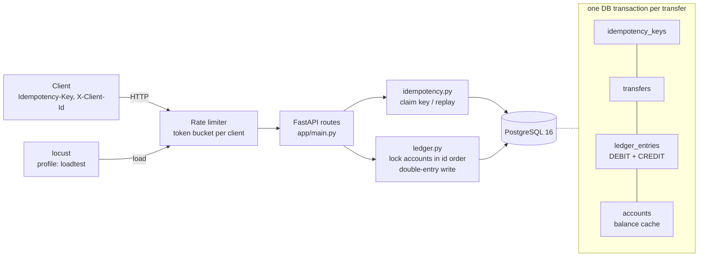

# Payment ledger service (correctness under failure)

A double-entry payment ledger API built with **FastAPI + PostgreSQL + SQLAlchemy**. It is designed for the
things payments engineering cares about most. Money is never created or lost, retries never pay twice,
parallel requests never corrupt a balance, and a database crash mid-transfer leaves no half-written payment.

- **Double-entry bookkeeping.** Every transfer writes one DEBIT and one CREDIT entry in the same DB transaction.
  Opening balances come from a system funding account, so *all balances always sum to 0*. That makes the ledger auditable.
- **Idempotency keys.** `POST /transfers` requires an `Idempotency-Key`. A retry returns the original response
  byte-for-byte (`Idempotent-Replayed: true`) and never moves money twice.
- **Concurrency safety.** Account rows are locked with `SELECT ... FOR UPDATE` in ascending id order, which
  prevents deadlocks. A `CHECK` constraint forbids negative balances.
- **Per-client rate limiting** with a token bucket (429 + `Retry-After`).
- **Tested for failure.** 44 pytest tests against real Postgres (including concurrency and invariant tests),
  a locust load test, and a drill that SIGKILLs Postgres in the middle of a stream of transfers.

## Architecture



What happens inside one database transaction for `POST /transfers`:
1. Claim the key (`INSERT ... ON CONFLICT DO NOTHING`).
2. Lock both accounts, lowest id first.
3. Check funds.
4. Insert the transfer and its 2 entries, and update both balances.
5. Store the response under the key.
6. **COMMIT**: everything or nothing.

## Run

```bash
docker compose up --build        # API: http://localhost:8001  (interactive docs: /docs)
                                 # Postgres: localhost:5434 (user/password/db: ledger)
```

Needs only Docker. In the measured run the largest memory sample was Postgres at 80.37 MiB, during the load test.
Settings (rate limit, load-test size) are listed in `.env.example`.

```bash
curl -X POST localhost:8001/accounts -H 'content-type: application/json' \
     -d '{"owner_name": "Asha", "initial_balance_paise": 50000}'          # -> id 2 (id 1 = system)
curl -X POST localhost:8001/accounts -H 'content-type: application/json' -d '{"owner_name": "Ravi"}'
curl -X POST localhost:8001/transfers -H 'content-type: application/json' \
     -H 'Idempotency-Key: order-1001' \
     -d '{"from_account_id": 2, "to_account_id": 3, "amount_paise": 12000}'  # run it twice!
curl localhost:8001/accounts/2/statement
```

| Endpoint | What it does |
|---|---|
| `POST /accounts` | Open an account; an opening balance is a funding transfer from the system account |
| `GET /accounts/{id}` | Balance (integer paise) |
| `GET /accounts/{id}/statement?limit=50` | Ledger entries, newest first, with running balance |
| `POST /transfers` | Move money; **requires `Idempotency-Key`**. 201 / 404 unknown account / 422 insufficient funds |
| `GET /transfers/{id}` | A transfer with its DEBIT and CREDIT entries |
| `GET /health` | API + database reachable (not rate limited) |

## Test

```bash
python3 -m venv .venv && .venv/bin/pip install -r requirements-dev.txt
docker compose up -d postgres            # tests use the separate `ledger_test` database inside it
.venv/bin/ruff check . && .venv/bin/pytest -v
```

GitHub Actions (`.github/workflows/ci.yml`) runs `ruff` and `pytest` on every push, with a Postgres service container.

Load test only: `docker compose --profile loadtest run --rm locust` (50 users, 60 s; CSVs go to `results/`).

## Measured results

Every number here comes from **one run** of one command, saved in
[results/measured_run.txt](results/measured_run.txt). The run was on an Apple M4 with 16 GB RAM and Docker Desktop with 10 CPUs / 7.7 GiB, at 2026-10-15T16:34Z:

```bash
./scripts/measure_all.sh      # ~2-3 min; deletes existing ledger data first
```

| What | Result |
|---|---|
| Test suite (real Postgres) | **44 passed** in 3.26 s, including 7 concurrency tests |
| 100 parallel transfers between the same 2 accounts (HTTP) | 100/100 succeeded in 338 ms; balances exact (₹900 / ₹100) |
| 50 A→B + 50 B→A at the same time | 100/100 succeeded, **0 deadlocks**, balances unchanged |
| Overdraft race: 100 parallel ₹1 transfers, ₹50 available | exactly **50 succeeded, 50 refused**, final balance ₹0 |
| Same Idempotency-Key sent 20× in parallel | money moved **once**; all 20 responses byte-identical |
| `POST /transfers` latency, 1,000 sequential requests | **p50 3.45 ms, p95 8.62 ms**, p99 19.05 ms |
| Load test (locust, 50 users, 60 s) | 24,159 requests, **0 failures**, **403 req/s** overall, of which 268.88/s new transfers. Transfer latency p50 110 ms, p95 200 ms, p99 280 ms |
| Ledger after the load test | **16,118** new transfers in DB = 16,118 that clients saw succeed. 1,983 of 1,983 retries replayed. Total of all balances = 0 |
| Postgres SIGKILLed mid-stream (300 transfers, retried with same keys) | **300/300** recorded exactly once. 12 attempts got 503 during a 2.60 s client-visible outage. Invariants hold |
| Rate limit (one client, 300 back-to-back requests) | 178 allowed / 122 got 429 in 1.58 s (token bucket bound: 179). Another client unaffected |
| Memory after the run | api 69.08 MiB, postgres 63.36 MiB |

The load test asked for 500 req/s (50 users × 10/s) and got 403. Sampled mid-run, the API container
used 141% CPU while Postgres used 24% and locust 16%. So the single-worker API is the bottleneck, not
the database. Details and caveats: [LEARNING.md §7](LEARNING.md#7-measured-results-one-run).

## Learn more
[LEARNING.md](LEARNING.md) is the study guide. It covers:
- a walk through one transfer, step by step;
- every file and the concept it shows;
- ACID, isolation, locks, deadlocks and idempotency, explained against this code;
- 10 "break it" exercises and 25 interview questions with answers.
